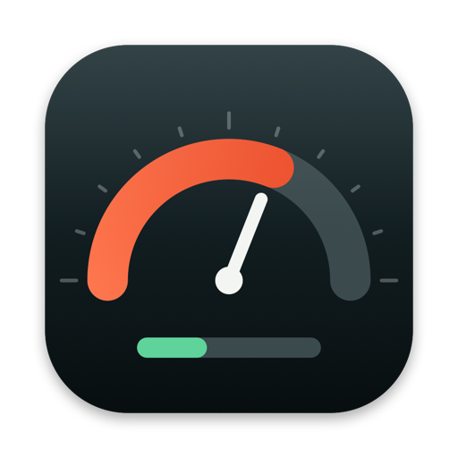
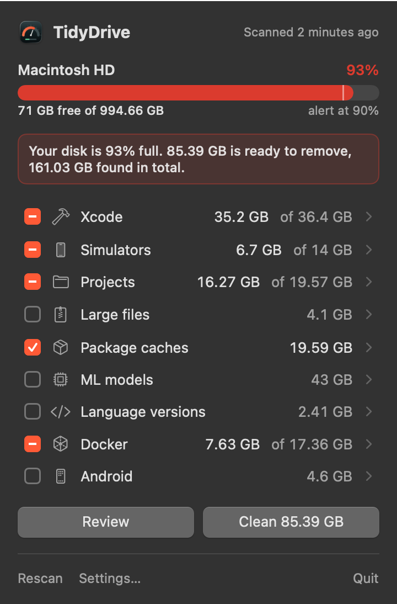
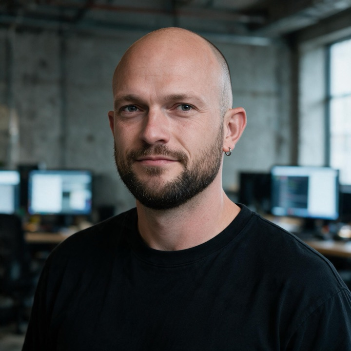

<p align="center">
  
</p>

<h1 align="center">TidyDrive</h1>

<p align="center">Your disk is full. Take it back.</p>

<p align="center">
  
</p>

https://github.com/reneweteling/tidydrive/raw/main/docs/public/assets/demo.mp4

 

A menu bar app for developers, by [René Weteling](https://www.weteling.com). It watches your disk, warns you once when it passes 90%, and shows what your tools left behind. You pick what goes.

Website: https://reneweteling.github.io/tidydrive/

## What it finds

| Category | What | Removed with |
|---|---|---|
| Xcode | DerivedData, DeviceSupport, Previews, simulator caches, archives, extra Xcode apps | delete, Xcode apps to the Trash |
| Simulators | Unavailable devices, simulators unused for 90 days, runtimes | `xcrun simctl delete` |
| Projects | Dependencies and build output for 20+ ecosystems: `node_modules`, `.next`, Rust `target`, Elixir `_build` and `deps`, `.venv`, `Pods`, `.gradle`, `vendor`... | delete |
| Large files | Files over 500 MB in your project folders | Trash |
| Package caches | npm, pnpm, Yarn, Bun, uv, pip, Cargo, Go, Hex, Bundler, Gradle, Maven, Homebrew, CocoaPods, Composer, NuGet, Playwright, editors and more | the tool's own clean command where it has one |
| ML models | Ollama, Hugging Face, LM Studio | `ollama rm`, delete |
| Language versions | Versions no project asks for, across asdf, mise, nvm, fnm, Volta, nodenv, rbenv, rvm, pyenv, uv, rustup, goenv, SDKMAN, fvm, tfenv, plus duplicate installs and old Homebrew formulas | the version manager's uninstall |
| Docker | Images and volumes per compose project, dangling images, stopped containers, build cache | `docker rmi`, `docker volume rm`, `docker builder prune` |
| Android | AVDs, SDK cache, old build-tools, system images | delete |

## How it decides

| Rule | Why |
|---|---|
| A folder counts only when its marker file sits next to it | `target/` next to `Cargo.toml` is Rust output; a lone `target/` stays |
| Anything git tracks is skipped | A committed `vendor/` or `dist/` is source |
| A project is stale after 60 days without a commit, never with uncommitted changes | Stale build output is preselected, active projects are not |
| A language version stays when a `.tool-versions`, `.nvmrc`, `mise.toml`, `rust-toolchain.toml`... points at it, and the newest per manager always stays | Removing a version a project needs breaks that project |
| Docker skips anything a running container uses | |
| Careful items are never preselected | Volumes, models, large files and language versions may be data that does not come back |
| Every delete passes a guard that refuses the home folder, personal folders, project roots and anything outside your home | A bug in a rule cannot reach your documents |

After cleaning, TidyDrive reports the free space measured on the volume, not the sizes the tools claim.

## Install

Download `TidyDrive.zip` from the [latest release](https://github.com/reneweteling/tidydrive/releases/latest), unzip, and drag `TidyDrive.app` to `/Applications`. Releases are signed with an Apple Developer ID and notarized.

Or build from source:

```bash
git clone https://github.com/reneweteling/tidydrive.git
cd tidydrive
./scripts/build.sh
cp -R build/TidyDrive.app /Applications/
```

Requires macOS 14 or later on Apple Silicon and the Xcode Command Line Tools.

## Command line

The app binary also scans without the menu bar. Nothing is removed.

```bash
/Applications/TidyDrive.app/Contents/MacOS/TidyDrive --report            # readable summary
/Applications/TidyDrive.app/Contents/MacOS/TidyDrive --report --json     # everything, as JSON
/Applications/TidyDrive.app/Contents/MacOS/TidyDrive --report --root ~/code
```

## Privacy

Crash reports go to Sentry with the app version and category names. No file names, paths or project names are sent. Switch it off in Settings, General. The update check asks the GitHub releases API once a day.

## Development

| Command | What |
|---|---|
| `swift test` | Core tests: safety guard, rules, version matching, Docker parsing, cleaner |
| `./scripts/build.sh` | Builds and ad-hoc signs `build/TidyDrive.app` |
| `.build/debug/TidyDrive --render-assets build/assets --demo` | Renders the screenshots with example data |
| `swift scripts/make-demo.swift build/assets docs/public/assets/demo.mp4` | Builds the demo video (needs ffmpeg) |

Releases run on every push to `main`: semantic-release picks the version from Conventional Commits, the macOS job tests, builds, signs, notarizes and attaches `TidyDrive.zip` to the GitHub release. The site in `docs/` deploys to GitHub Pages.

## Made by



**René Weteling**, agentic developer. I orchestrate AI agents that design, code, test and ship. TidyDrive went from a sketch to a signed, notarized release in a single day.

Need that on your own product? Start a project at [weteling.com](https://www.weteling.com). Also by me: [Loft](https://reneweteling.github.io/loft-app/), drag a file to your menu bar and get a link back.

<br clear="left">

## License

[PolyForm Noncommercial 1.0.0](LICENSE.md). Copyright Felobo B.V. See [CONTRIBUTING.md](CONTRIBUTING.md).
